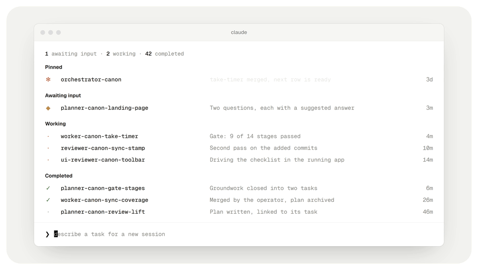

<div align="center">

<picture>
 <source media="(prefers-color-scheme: dark)" srcset="assets/brand/mark-color.svg">
 
</picture>

# canon

A Claude Code plugin and CLI that runs agent work from plan to merge.

[](https://www.npmjs.com/package/@erclx/canon)
[](https://github.com/erclx/canon/actions/workflows/verify.yml)
[](LICENSE)

<picture>
 <source media="(prefers-color-scheme: dark)" srcset="assets/loops/readme.gif">
 
</picture>

</div>

## Quick start

```bash
claude plugin marketplace add https://github.com/erclx/canon
claude plugin install canon@canon
bun install --global @erclx/canon
```

Then open a project in Claude Code and run `/canon:target-setup`, which brings it onto canon.

canon expects someone who already knows Claude Code well. It runs on Linux and macOS, and the CLI needs Bun.

## Five roles, each in its own session

You talk to the orchestrator, which starts the others and hears back from each.

- The orchestrator dispatches the rows on the task board
- A planner reads the code and writes one plan you approve
- A worker builds the plan and opens the pull request
- A code reviewer reads the diff from a fresh session
- A UI reviewer drives the visual checklist in the running app

## The record each step writes

Each record has a fixed shape, so the next session knows where to read. Records live under `.canon/` in the main checkout.

- Before a build: intake, groundwork, the plan, its task, and the board
- Around a pull request: the code review, the UI review, and the screenshot evidence
- Across sessions: the drive log, the context entries, and the handoff a compaction would lose

## Practice skills with cited sources

Each skill loads when its kind of work starts, and every rule names where it came from.

| Skill                  | Loads                           | Cites                                     |
| ---------------------- | ------------------------------- | ----------------------------------------- |
| `code-craft`           | Before a new function or module | Google, What to look for in a code review |
| `test-craft`           | Before writing a test           | Ham Vocke, The Practical Test Pyramid     |
| `api-design`           | Before shaping a flag or output | Software Engineering at Google            |
| `ui-craft`             | When a rendered file changes    | W3C, Using ARIA                           |
| `systematic-debugging` | On a bug nobody has explained   | Jesse Vincent, superpowers                |

Each rule has its own source row in a ledger, and the skill audit fails when a skill's rules and its rows disagree in count.

## Checks that catch a skipped step

A skill says what good looks like. These four parts hold the agent to it.

- Rules by path load when the agent opens a matching file, and each names the skill that owns that kind of file
- Hooks read each action before or after it runs, refusing some and reporting others back into the same turn
- The gate runs every stage before a pull request opens, and a stage that cannot read its input fails rather than passing
- A deny rule keeps the agent from merging, since a hook fails open on a timeout and a permission rule does not

## One worktree for each change

Changes run side by side. Each worker builds in its own worktree on its own branch, and every session reads and writes the one `.canon/` record in the main checkout, so no worktree keeps a copy of its own.

## Setting up a project

The project starts with its stack's own tool, such as `bun init` or `npm create vite`, or with `/canon:target-scaffold` in an empty folder, and canon layers on top.

1. `/canon:target-setup` detects the stack, shows the whole chain, and writes nothing until you say yes. Then it runs `canon init`, checks what landed, and indexes the docs.
2. `/canon:target-check` reports, domain by domain, what the project holds against what canon now ships, and repairs nothing.
3. `/canon:target-update` upgrades the CLI and plugin after a release, previews the changelog and any migrations, and catches the project up on your go-ahead.

Three kinds of file land in your repo:

- Skills load live from the plugin, so there is no copy to drift
- Rules are files under `.claude/rules/` that load when you edit a matching path
- Configs and seeds are real files you own, laid down by `canon init` and kept current by `canon sync`

## For your agent

- Every command runs without a prompt, and data on stdout pipes clean
- `canon <command> --help` prints each command's flags, exit codes, and examples
- Rules load by path, so the agent gets the rule for the file it is editing

## Docs

- [AI workflow](docs/workflow/ai-workflow.md): the loop a feature runs
- [Operating model](docs/workflow/operating-model.md): planners, workers, and reviewers in parallel
- [Skill map](docs/workflow/skill-map.md): every skill by the moment you reach for it
- [Agents](docs/agents/index.md): flags, exit codes, and output shapes
- [Docs index](docs/index.md): every reference doc, updating canon among them

## Contributing

Issues are welcome. Pull requests are by invitation, so read the [contributing guide](CONTRIBUTING.md) before you open one. Released under the [MIT license](LICENSE).
