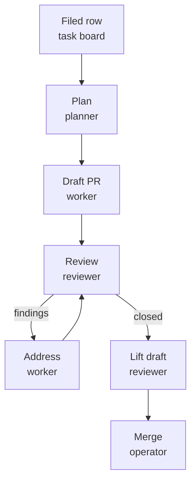

# Plan to merge

One row moves through four kinds of session before it lands. This page follows an invented one, adding a tide table export to a tide-table app called Tidewell, so you can see which session holds each step and what it leaves for the next. The rules behind each step live in [the operating model](operating-model.md) and in the skills named below.

<figure>

<figcaption>Each box is a different session. The record it leaves is the only thing the next one reads.</figcaption>
</figure>

## File the row

Tidewell users keep asking for a tide table export, and you say so in any session. A pile of such asks goes through `canon:plan-intake`. One clear ask goes through `canon:task-create`, which leaves the row under Needs a plan in `priority.md`, and the orchestrator moves it from there.

The row is now a record on the board, with no code and no plan behind it.

## Plan it

The orchestrator dispatches a planner, a session that loads `canon:role-planner` and runs `canon:plan-change` on the task. The planner reads the tree, writes `.canon/plans/feature-tide-table-export.md`, and links it from the row.

The plan names the files to touch, the risks, the weight, and any question it cannot settle alone. A question left blank accepts its suggested answer at build time, so only a question marked as needing your call holds the row.

## Build it

The orchestrator checks that the plan waits on nobody and that no track in flight conflicts, then launches a worker in the background. The worker loads `canon:role-worker` through `canon:auto-ship`, enters its own worktree, and builds the plan in slices.

When the checks pass, `canon:git-ship --draft` opens the pull request as a draft and the worker messages the orchestrator with the number and head. A UI change also gets a `canon:pr-evidence` comment holding screenshots and a checklist. The draft mark holds the merge until the reviews close.

## Review it

The orchestrator dispatches a reviewer, a fresh session that loads `canon:role-reviewer` and runs `canon:review-pr` on the pull request. It never saw the build, so it reads only the diff and the plan. A UI box a person does not need to judge goes to `canon:review-ui`.

A pass posts a `## Review` comment while any finding is open. The reviewer then tells the worker to run `canon:review-address`.

## Address it

The worker fixes each finding, replies on the pull request, rebases if `main` moved, and pushes. It asks the reviewer to look again with the new head, and the loop repeats until a pass finds nothing. That pass posts `## Review closed`.

Every round leaves its trace on the pull request itself, so a session picking up mid-loop reads the thread rather than asking anyone.

## Lift and merge

On a close, the reviewer runs `canon pr lift`, which takes the pull request out of draft once every gate it reads passes. Nothing merges yet.

You run `canon pr merge <number>`, or name the pull request for the orchestrator to merge. The `post-merge` hook then archives the task and its plan. Run `/git-worktree cleanup` to remove the worker's worktree.

## What you do by hand

Most steps run without you. These are yours.

- File the row and answer any plan question marked as needing your call
- Approve a billed run, such as a sandbox pass, before it starts
- Decide the merge, for a named pull request or under a standing authorization you grant

For when to pick a different path, such as one session that plans and builds a small row, see the scenarios in [AI workflow](ai-workflow.md).
